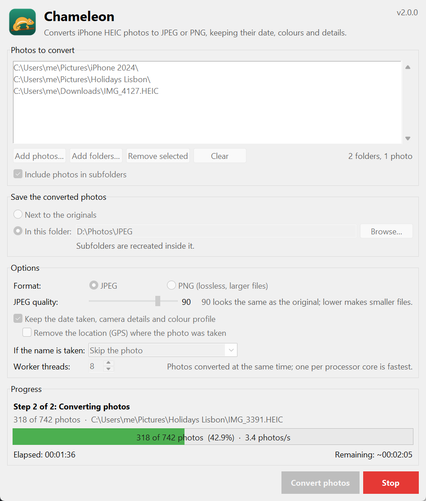

<p align="center">
  
</p>

<h1 align="center">Chameleon</h1>

<p align="center">
  Converts iPhone HEIC photos to JPEG or PNG, keeping their date, colours and details.
</p>

<p align="center">
  
</p>

iPhones save photos as HEIC, which many programs, websites and older computers
can't open. Add your photos or whole folders to Chameleon, choose where the
converted copies should go, and it turns every HEIC photo into a JPEG (or PNG)
that opens everywhere. The originals are never changed.

## Features

- **Nothing lost on the way.** The date taken, camera details and the colour
  profile are copied to the new photo, so it sorts correctly in photo apps and its
  colours look the same as on the phone. Rotated photos come out upright.
- **Privacy option.** Remove the location (GPS) where each photo was taken, and
  keep everything else.
- **Whole folders at once.** Add photos one by one or entire folders, including
  their subfolders. Ctrl- or Shift-click several folders in the folder picker.
- **Your choice of output.** Save the converted photos next to the originals, or
  in another folder with the same subfolder structure. JPEG with adjustable
  quality, or lossless PNG.
- **Fast.** Photos are converted in parallel, one per processor core.
- **Live progress.** Photos done, photos per second, time elapsed and time left.
  **Stop** at any time; nothing half-written is left behind.
- **Safe with existing files.** Skip, replace or keep both when a converted name
  is already taken.
- **Remembers your choices** for next time.
- **Command line too.** `chameleon-cli` does the same from a terminal or script.

## Requirements

- Python **3.10 or newer** with Tkinter.
  - Windows and macOS: the installers from [python.org](https://www.python.org/downloads/) include Tkinter.
  - Linux: install it from your package manager, e.g. `sudo apt install python3-tk` (Debian/Ubuntu)
    or `sudo dnf install python3-tkinter` (Fedora).
- [Pillow](https://python-pillow.github.io/) and [pillow-heif](https://github.com/bigcat88/pillow_heif),
  installed automatically below.

You don't need Python at all if you use a prebuilt `Chameleon.exe`
(see [Building a standalone executable](#building-a-standalone-executable)).

## Installation

Clone or download the project, then create a virtual environment inside it.

**Windows (PowerShell)**

```powershell
cd chameleon
py -m venv .venv
.venv\Scripts\Activate.ps1
pip install .
```

**macOS / Linux**

```bash
cd chameleon
python3 -m venv .venv
source .venv/bin/activate
pip install .
```

`pip install .` adds two commands: `chameleon` opens the app and `chameleon-cli`
converts from the terminal. Use `pip install -e ".[dev]"` instead if you plan to
change the code.

## Running

Either of these opens the window:

```bash
chameleon
```

```bash
python -m chameleon
```

The second also works straight from a checkout after `pip install -r requirements.txt`.

From a terminal, `chameleon-cli` converts the photos in the current folder, like
the original Chameleon script did:

```bash
chameleon-cli
```

```bash
chameleon-cli "D:\Phone backup" --recursive --output "D:\Phone backup JPEG" --remove-location
```

Run `chameleon-cli --help` for every option.

## Quick start

1. Click **Add folders…** (or **Add photos…**) and choose what to convert.
2. Choose where to save the converted photos: **Next to the originals**, or
   **In this folder** and pick one.
3. Check the options: JPEG or PNG, quality, whether to keep the photo details and
   remove the location.
4. Click **Convert photos**. A summary appears when it's done, and you can open
   the folder with the results.

The [user guide](docs/USER_GUIDE.md) covers every option, what happens to the
photo details, and troubleshooting.

## How it works

| Step | What happens |
|------|--------------|
| 1. Looking for photos | Every chosen folder is searched (alphabetically, optionally with its subfolders) for `.heic`, `.heif` and `.hif` files, and each photo gets its output name. Names already taken are skipped, replaced or numbered. |
| 2. Converting | Photos are decoded by libheif (through pillow-heif) and saved by Pillow, several at a time. Each file is written under a temporary name and renamed when complete, then given the original's modification time. |

More detail is in [ARCHITECTURE.md](docs/ARCHITECTURE.md).

## Building a standalone executable

[PyInstaller](https://pyinstaller.org/) can bundle Chameleon, Python and libheif
into a single program, with the Chameleon icon, for people who don't have Python
installed:

```bash
pip install -r requirements-dev.txt
pyinstaller packaging/chameleon.spec
```

The result is `dist/Chameleon.exe` on Windows (`dist/Chameleon` on macOS/Linux).
Build on the operating system you are targeting.

## Development

```bash
pip install -r requirements-dev.txt
pytest
```

The tests create real HEIC photos with pillow-heif, so they need no sample files.
The icon is drawn by `scripts/generate_icon.py`; run it again after changing the design.
See [CONTRIBUTING.md](CONTRIBUTING.md) for the project layout and conventions.

## Project structure

```text
chameleon/
├── chameleon/               the application package
│   ├── __main__.py          `python -m chameleon`
│   ├── app.py               entry point: creates the window
│   ├── cli.py               the `chameleon-cli` command
│   ├── core/                the conversion, no GUI code
│   │   ├── engine.py        the 2-step job, output names and the thread pool
│   │   ├── converter.py     converting one photo, keeping its metadata
│   │   ├── scanner.py       finding HEIC photos in files and folders
│   │   ├── progress.py      thread-safe counters, speed and time left
│   │   ├── settings.py      remembered choices
│   │   ├── models.py        data passed between engine, GUI and command line
│   │   └── errors.py
│   ├── gui/                 Tkinter interface
│   │   ├── main_window.py   the main window
│   │   ├── widgets.py       photo list, text progress bar, problems dialog
│   │   ├── folder_picker.py choosing several folders at once
│   │   ├── _win_folder_dialog.py  native Windows multi-folder dialog (ctypes)
│   │   └── icon.py          window icon and the header logo
│   ├── utils/               formatting and path helpers
│   └── assets/              icon files
├── tests/                   pytest suite
├── docs/                    user guide, architecture notes, screenshot
├── packaging/               PyInstaller recipe and the pillow-heif hook
├── scripts/                 icon generator
├── pyproject.toml           package metadata
└── requirements*.txt        dependencies
```

## License

Chameleon is released under the [MIT License](LICENSE).
